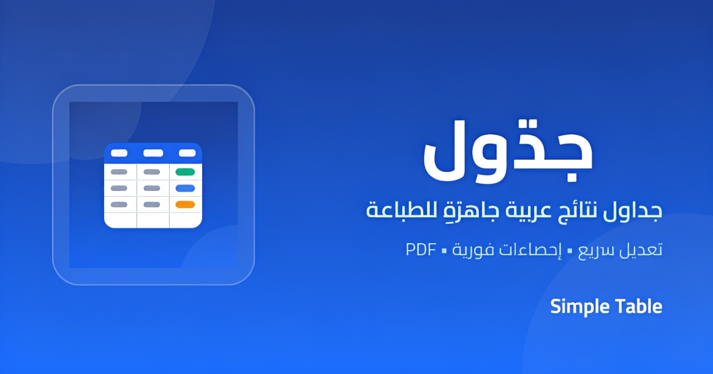

# Simple Table

[](https://simple--table.vercel.app)

> A fast, no-fuss table builder for everyday work — made to get a table on paper in minutes, not to fight with spreadsheets.

Simple Table is an Arabic-first (RTL) web app for creating, editing, and printing result tables. It was built as a personal work tool: open the page, type your rows, hit print — that's the whole workflow.

**Live demo:** <https://simple--table.vercel.app>

---

## Highlights

- **Ready instantly** — the page opens with an empty report shell: the `#`, `الكود`, `الاسم` and `الدرجة` columns are already in place, so you hit **إضافة صف** and start typing
- **Always-editable data** — every cell, including grades, can be edited in view mode; no need to enter edit mode just to correct a value. Double-click anywhere inside a cell to focus and select its input
- **Fast row management** — **إضافة صف** adds a row instantly, while double-clicking it opens a dialog to add several rows at once or set the exact total. **حذف آخر صف** removes the last row, and `Shift` + `Numpad +` / `Shift` + `Numpad −` work as keyboard shortcuts
- **Edit mode** — one toggle reveals the structural tools:
  - move rows and columns around
  - rename columns inline
  - drag or nudge column widths
  - remove individual rows and add/remove columns
  - attach a photo and one or more tags to a name cell
  - edit the signature (the title stays editable at all times)
- **Grade colouring** — grades are bucketed automatically into four tiers: **18+** green, **14+** blue, **10+** amber, below that red. A `0` is stored as `#` (absent) and still counts as zero in the statistics
- **Sorting** — sort by name (the `الاسم` column) or by grade, ascending or descending, straight from the sort menu
- **Three layouts** — *Classic* (banded rows), *Soft* (light banding) and *Compact* (tight rows) to match what you're printing
- **Live statistics** — count, average, most common score and highest score, updated as you type
- **Print & PDF** — the print dialog can print every table, only the current one, or a hand-picked selection; each sheet carries its own header, statistics, signature line, and a header row that repeats on every page
- **Editable title & signature** — the blue band doubles as the report title, and the signature under the table is editable in edit mode
- **Multiple tables** — tabs keep separate tables side by side, each with its own rows, columns and signature. New tabs get unique names, and closing a tab asks for confirmation
- **Themes** — light/dark mode (remembered between visits), full Arabic RTL interface, and a proper installable PWA with an offline app shell
- **Auto-saved** — everything persists in your browser's local storage with a visible save status; export a backup if storage is unavailable, or clear all saved tables from the toolbar
- **Private by design** — no account, no server, no analytics, no uploads, and no external requests. Cairo is self-hosted and photos never leave the browser
- **Accessible** — keyboard-operable tabs, dialogs, and column resize handles; labelled inputs; visible focus states; and a tested light/dark contrast palette

---

## Tech stack

| Layer    | Choice                                             |
| -------- | -------------------------------------------------- |
| UI       | [React 19](https://react.dev) + TypeScript 6       |
| Styling  | Tailwind CSS 4 (CSS-first, PostCSS)                |
| Build    | [Vite](https://vite.dev) 8                         |
| Icons    | lucide-react                                       |
| Linting  | oxlint                                             |
| Testing  | Vitest                                             |
| PWA      | Web app manifest + service worker + Cairo woff2    |

---

## Getting started

Requires Node.js 22.12 or newer (see `.nvmrc`).

```bash
npm install
npm run dev
```

Then open the printed local URL (usually `http://localhost:5173`).

## All commands

| Command             | What it does                                      |
| ------------------- | ------------------------------------------------- |
| `npm run dev`       | Start the dev server with HMR                     |
| `npm run build`     | Type-check (`tsc -b`) and build for production     |
| `npm run preview`   | Serve the production build                        |
| `npm run lint`      | Run oxlint                                        |
| `npm test`          | Run the unit tests once                           |
| `npm run test:watch`| Run the unit tests in watch mode                  |

## Testing

The unit tests cover grade normalization and tiers, table normalization and recovery from malformed storage, grade statistics, storage failure handling, and ID generation.

```bash
npm test
```

The production build also type-checks the tests, so `npm run build` catches type regressions. For manual browser verification, test both themes, view/edit modes, printing, image uploads, offline reload, and a corrupted `exam-tables` value.

---

## Notes

- A new table starts empty — only the `الكود` / `الاسم` / `الدرجة` columns are pre-defined; add rows with **إضافة صف** (double-click for a custom row count) and columns with **إضافة عمود** (edit mode).
- Everything lives in your browser, under these `localStorage` keys:

  | Key                | What it holds                                                        |
  | ------------------ | -------------------------------------------------------------------- |
  | `exam-tables`      | every table (rows, columns, title, signature, cell photos and tags)  |
  | `exam-table-style` | the selected layout (`classic` / `soft` / `compact`)                 |
  | `tdaim-theme`      | `light` or `dark`                                                    |

  No account, no server, no uploads, and no external requests. Cairo is served from `public/fonts`, and the service worker caches the app shell for offline use after the first visit.
- Cell photos are validated, downscaled to at most 512 px, re-encoded as JPEG, and embedded as base64 data URLs inside `exam-tables`. They count against the browser's storage quota (usually around 5 MB), so keep them small.
- Printing is handled by the browser's own print dialog, so "Save as PDF" is always an option. The document title is set to the printed table names first, so the saved PDF gets a meaningful filename, then restored.
- **Clear all data** removes `exam-tables` and resets the app to a fresh table; the theme and layout preferences are kept.
- The production deployment includes `vercel.json` with a strict Content Security Policy, security headers, immutable asset caching, and no-cache rules for the HTML shell and service worker.
- Cairo is distributed under the SIL Open Font License 1.1; the license is included at `public/fonts/OFL.txt`.
